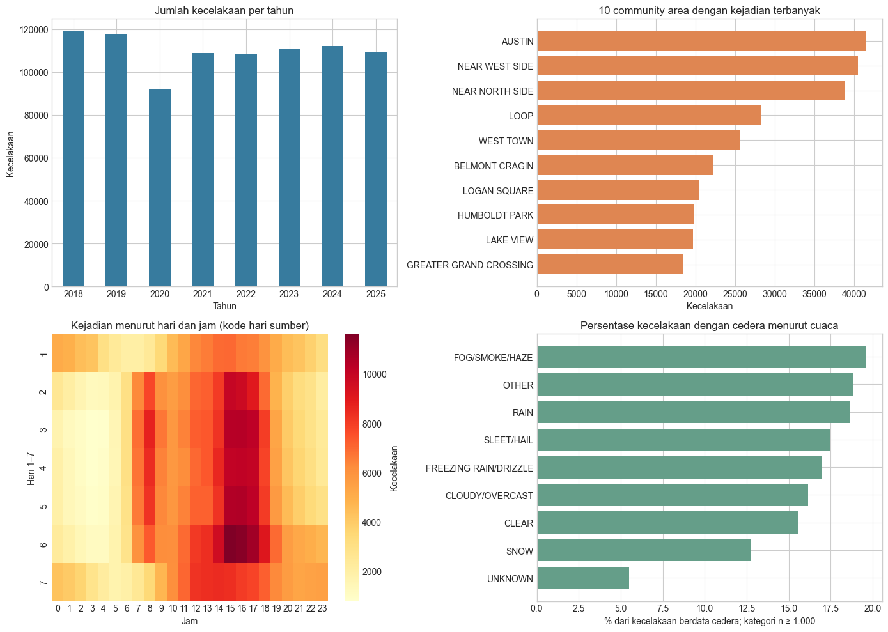

# Preprocessing kecelakaan lalu lintas Chicago

Proyek Rekayasa Data ini membersihkan, mengintegrasikan, dan mereduksi data kecelakaan lalu lintas Chicago periode 2018–2025. Tiga tabel sumber memiliki grain berbeda: satu baris per kecelakaan, unit kendaraan, dan orang. Notebook mempertahankan grain tersebut saat integrasi dan menyimpan audit untuk keputusan cleaning serta pencocokan data.



## Hasil dari salinan data yang dianalisis

| Tahap | Hasil |
| --- | ---: |
| Sumber Crashes | 877.921 baris |
| Sumber Vehicles | 1.792.372 baris |
| Sumber People | 1.927.657 baris |
| Crashes setelah integrasi | 877.921 baris, 67 atribut |
| Crashes untuk analisis | 877.921 baris, 15 atribut |
| Ringkasan community area | 77 baris |
| Ringkasan hari × jam | 168 baris |

Cleaning mempertahankan jumlah baris pada ketiga tabel. Pemilihan atribut mengurangi 52 dari 67 atribut tabel kecelakaan terintegrasi (77,6%). Angka ini berasal dari output notebook pada salinan data lokal, sehingga dapat berbeda jika sumber diperbarui.

## Alur kerja

1. **Profil dan cleaning:** baca CSV per chunk, audit nilai kosong dan duplikat, keluarkan atribut dengan lebih dari 30% nilai kosong, normalisasi tipe dan nilai domain. Nilai sumber yang tidak dapat dipastikan tetap kosong atau disimpan bersama penanda estimasi.
2. **Integrasi:** hubungkan tabel melalui `crash_record_id`; pencocokan orang ke unit juga memeriksa `vehicle_id` dalam kecelakaan yang sama. Ringkasan dihitung sebelum join agar jumlah kejadian tidak berlipat.
3. **Pemetaan wilayah:** gunakan koordinat sumber atau estimasi alamat yang diberi jejak asal untuk menghubungkan kecelakaan ke poligon community area Chicago.
4. **Reduksi dan analisis:** pilih atribut kejadian yang relevan, buat agregat area serta hari-jam, lalu periksa redundansi dengan korelasi, kovarians, dan kesamaan nilai.

Pemrosesan tabel besar memakai batch Parquet dan indeks SQLite sementara. Metode, konflik, dan baris yang tidak berhasil dipetakan dicatat di berkas audit dalam `chicago_traffic/processed/`.

## Menjalankan ulang

Gunakan Python 3.11. Dari direktori proyek:

```powershell
py -3.11 -m venv .venv
.\.venv\Scripts\Activate.ps1
python -m pip install -r requirements.txt
```

Unduh CSV dari portal resmi City of Chicago dengan filter `crash_date >= 2018-01-01` dan `crash_date < 2026-01-01`. Simpan hasilnya di direktori `chicago_traffic/` dengan nama berikut. Header CSV harus memakai nama kolom sumber dalam huruf kecil seperti `crash_record_id` dan `crash_date`.

| Dataset | Nama file lokal |
| --- | --- |
| [Traffic Crashes – Crashes](https://data.cityofchicago.org/Transportation/Traffic-Crashes-Crashes/85ca-t3if/about_data) | `traffic_crashes_crashes_2018_2025.csv` |
| [Traffic Crashes – Vehicles](https://data.cityofchicago.org/Transportation/Traffic-Crashes-Vehicles/68nd-jvt3/about_data) | `traffic_crashes_vehicles_2018_2025.csv` |
| [Traffic Crashes – People](https://data.cityofchicago.org/Transportation/Traffic-Crashes-People/u6pd-qa9d/about_data) | `traffic_crashes_people_2018_2025.csv` |

Jalankan Jupyter dari **direktori proyek** agar path relatif notebook benar:

```powershell
jupyter lab "Notebook Individual Project.ipynb"
```

Jalankan semua sel secara berurutan. Notebook mengambil [poligon community area](https://data.cityofchicago.org/d/igwz-8jzy) dan mengakses geocoder US Census untuk estimasi alamat, sehingga koneksi internet diperlukan saat cache belum tersedia. CSV mentah, cache, dan hasil Parquet sengaja tidak disertakan dalam repository; sediakan ruang disk tambahan untuk menjalankan pipeline penuh.

## Berkas utama

- [Notebook analisis](Notebook%20Individual%20Project.ipynb) — kode, output, visualisasi, dan interpretasi.
- [Modul cleaning](traffic_crash_pipeline.py) — pipeline cleaning berbasis batch yang dipanggil notebook.
- [Laporan PDF](Laporan%20Individual%20Project%20v2.pdf) dan [sumber LaTeX](traffic-crash-preprocessing-report.tex).
- [Presentasi PDF](PPT%20Individual%20Project.pdf).

**Batas interpretasi:** jumlah kecelakaan per area atau kondisi cuaca tidak langsung menyatakan risiko, karena data paparan perjalanan tidak tersedia. Koordinat hasil geocoder adalah estimasi alamat, bukan lokasi kejadian yang terverifikasi.
